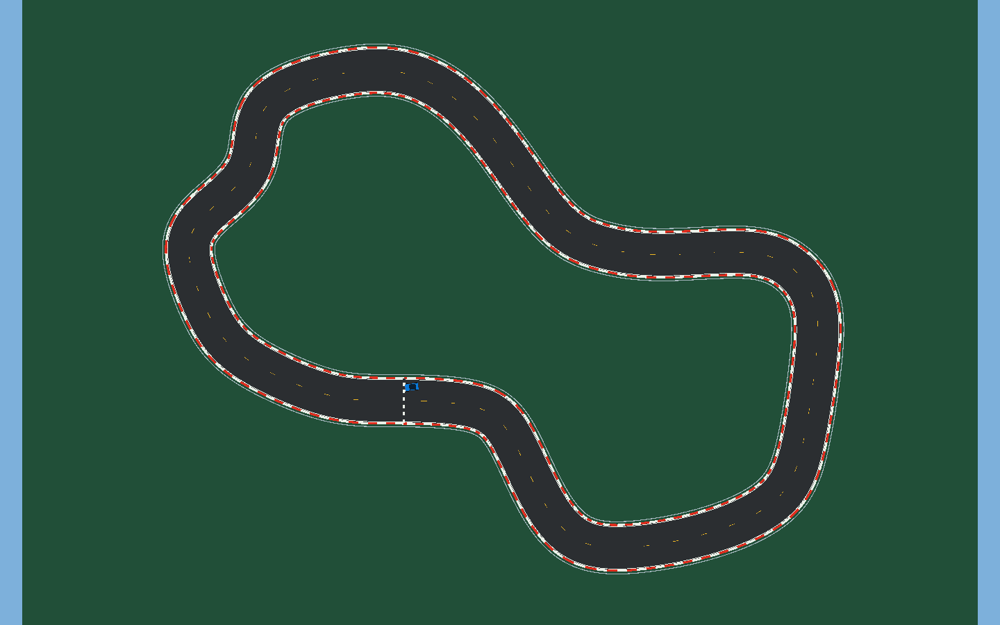

# Circuit geometry and scene consistency

The circuit follows a supplied outline with smoothed transitions: an inward section on the left, a diagonal upper section, and a broad right-hand section. It is a closed B-spline approximately **482.47 m** long, with a **12 m** road and turns in both directions. The [reference drawing](Circuit-reference.png) has a white background so its originally transparent black outline remains visible.

The plan is historical geometry evidence. It predates the denser center dashes, trees, and blue barrier update.

## Current road and scenery

| Element | Implementation |
|---|---|
| Road and curbs | Five continuous generated meshes saved in `Assets/JevVision/Generated` |
| Barriers | 1,208 collidable segments, blue RGB (0.02, 0.22, 0.95), height 1.5 m, base at ground level |
| Centerline | 120 yellow dashes, 1.6 m long and 0.12 m wide, placed every 4 m |
| Trees | 133 low-poly trees with simple trunks and two-tier, six-sided crowns |
| Start and evaluation | Start pose and 16 invisible trigger checkpoints derived from the same curve |

Barrier dimensions and color are stored in the saved scene, the shared `Rail` material, and the scene generator. Trees use deterministic variations in size, placement, rotation, and green palette. Placement checks distance from the whole circuit to keep crowns outside the road and beyond the barriers. Trees have no colliders and are visible to the model's front camera.

`RuntimeValidation.Start` calls the center-dash and tree helpers during normal startup as well as validation. Existing groups prevent duplicate generation. Older scenes can therefore receive the denser dashes and roadside trees without a full scene rebuild.

## Regenerating the scene

Use **JEV Vision → Create or rebuild circuit scene** after changing generated geometry, camera placement/FOV, or checkpoint settings. Road, barriers, car, start pose, and checkpoints are rebuilt together from the current code and configuration.

**JEV Vision → Build Windows player and validate** also recreates the scene before running checks and building. Manual edits to the generated scene may therefore be overwritten. Preserve intended changes in `SceneFactory`, the configuration asset, or the generator's material palette before rebuilding.

The optional editor build bridge compares source-content hashes rather than file timestamps before requesting compilation. This avoids unnecessary rebuilds caused by changed timestamps on synchronized files. It only acts on a local `Validation/build.request`; ordinary documentation edits do not request a build.

## Geometry mismatch protection

An earlier scene still contained the original oval while the evaluator scripts had already switched to the new spline. The affected local session recorded a **24.03 m** centerline error at startup, an `off_track` reset after roughly 4 s, and then a `stuck` reset. The car was being reset to the new curve's start inside the old scene geometry.

The fix regenerates road, vehicle, barriers, and checkpoints together. `TrackLayout` stores a signature of the generated geometry. If width, control points, or sampling no longer match, `ExperimentManager` keeps driving paused and displays **Scena da rigenerare**. Rebuild the scene and restart Play to resume.

## Evaluation stays separate from driving

Curve control points, checkpoint positions, and centerline distances are construction/evaluation data. The JEV controller receives none of them. `ExperimentManager` can pause or reset attempts and record progress, but it never supplies steering or throttle corrections.

Geometry checks cover circuit closure, left and right bends, sampled distances, saved meshes, 16 invisible gates, and the consistency signature. Negative checks change road width or a control point without regenerating geometry and require a mismatch to be detected.

## Evidence

- [October 25 history](../Validation/HISTORY-2026-10-25.md): original oval and mixed-circuit laps using the now-removed color-based driver.
- [October 28 history](../Validation/HISTORY-2026-10-28.md): initial real JEV requests, scenery changes, and superseded protocol experiments.
- [Current validation status](../Validation/RESULTS.md): current source behavior and the limits of existing build and driving evidence.

The historical local-controller laps are not JEV laps. The archived JEV image and smoke tests do not establish a complete autonomous lap.
