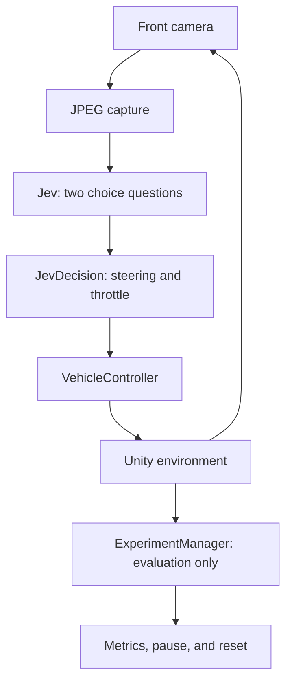

# JEV Vision Lab — project guide

This Unity prototype uses Jev to drive around a closed circuit from front-camera images. Its only autonomous controller is JEV Vision; Manual mode is available for driving and checking the vehicle physics. The previous color-based driver was removed on October 28, 2026.

Project versions: **Unity 6000.3.26f1**, **URP 17.3.0**, and **Input System 1.20.0**. Open this directory (`My project`) in Unity Hub. Documentation updated November 1, 2026.

## Start in the editor

1. Open `Assets/Scenes/JevVisionCircuit.unity`.
2. For JEV mode, run the key setup script from this directory:

   ```powershell
   powershell -ExecutionPolicy Bypass -File scripts/set-jev-key.ps1
   ```

3. Press Play in the Unity editor. The startup panel, **PREPARA LA GUIDA**, appears with the car held and no API requests.
4. Choose **Manuale** or **JEV Vision**, maximum speed from **0.5 to 8 m/s**, and, for JEV, a requested frequency from **0.2 to 10 calls/s**. Sliders and numeric fields support decimal points or commas. Speed is also displayed in km/h.
5. Press **PLAY · AVVIA GUIDA** inside the game. Manual mode needs no API key; JEV mode starts sending images and may consume API credit.

The UI currently uses Italian labels. Settings apply to a shared runtime copy of the configuration asset and are written to the session's `config.json`. They do not overwrite the project asset. Keyboard shortcuts do not bypass the startup screen. The session timer starts with driving and stops during pauses.

## Controls and decision display

| Control | Action |
|---|---|
| 1 | Switch to Manual; no API calls |
| 2 | Switch to JEV Vision; 3 is a compatibility alias |
| W / Up Arrow | Manual acceleration |
| A-D / Left-Right Arrow | Manual steering |
| P | Pause or resume the vehicle |
| R | Reset the attempt |
| C | Switch observer camera between chase and overview |

Release the accelerator to coast. Pause holds the Rigidbody in place. The current driving protocol has no active braking command.

The large **DECISIONI JEV** panel at the top right shows the model's steering and throttle choices and whether they are being applied. The debug overlay adds the actual JPEG preview and raw response below it. The HUD also exposes mode, pause, reset, API counters, latency, and session settings. The model's camera excludes the HUD and invisible evaluation gates.

## Credentials

The key setup script prompts with hidden input and saves **`TYPESAFE_API_KEY`** in the Windows user environment, under `HKEY_CURRENT_USER\Environment`. This is persistent local configuration, not an encrypted secret vault. Run the script again to replace the key.

`JevClient` reads the process environment first, then the Windows user environment. It sends the key only through the Authorization header to the configured HTTPS endpoint. The key is not part of the JSON request, image, configuration asset, or session logs. The client disables redirects and redacts the configured key from response text.

To remove the user-scoped value:

```powershell
[Environment]::SetEnvironmentVariable('TYPESAFE_API_KEY', $null, 'User')
```

The repository contains the variable name and setup code, not a shared API key. Each user supplies their own credential. For a shared hosted application, keep the service credential on a backend. `.env`, `.env.*` except `.env.example`, `*.key`, local runs, and generated build folders are ignored by Git; exclusions do not remove files already committed to history.

## Configuration

Select `Assets/JevVision/Resources/ExperimentSettings.asset` to change defaults.

| Setting | Default |
|---|---|
| Start Mode | JevVision, selected on the startup screen |
| Maximum Speed | 1.2 m/s |
| Decisions Per Second | 2 requested calls/s; one request in flight |
| Maximum Steering Degrees | 24° |
| Throttle Scale | 0.7 |
| Camera image | JPEG 280 × 280, quality 80 |
| Camera pose | FOV 65°, height 1.5 m, pitch 8° |
| HTTP timeout | 8 s |
| Maximum Decision Age | 2 s from capture, adjusted for slow schedules |
| Maximum Backoff | 30 s |
| Model | `jev-1.14.0` |
| Maximum API Calls Per Session | 600 |
| Maximum Estimated Cost | USD 0.05 |
| Attempt Timeout | 600 s |

On starting a session, the allowed decision age becomes the greater of its configured value and `1 / callsPerSecond + 0.5` seconds. The actual request rate may be lower than the requested rate because of latency or retry delays. Requests are never queued to catch up.

Rebuild the scene after changing the camera's generated pose/FOV or track/checkpoint geometry. The vehicle uses Rigidbody contacts and a bicycle-style steering model, with rolling resistance and lateral damping. Roll and pitch are constrained; realistic suspension is not simulated.

## Camera-only control path



| Component | Responsibility |
|---|---|
| `VehicleController` | Apply steering, acceleration, speed cap, and physics contacts |
| `CameraCapture` | Render the front camera through URP, encode JPEG, and timestamp capture |
| `JevProtocol` / `JevClient` | Build the structured request, send asynchronous HTTPS, and parse answers |
| `AutonomousController` | Select mode, schedule requests, reject stale responses, and enforce API budgets |
| `ExperimentManager` / `LapCheckpoint` | Evaluate progress and trigger pauses or resets |
| `TelemetryLogger` / `TelemetryHud` | Save session evidence and display decisions and metrics |
| `SceneFactory` / `ProjectTools` | Generate the scene, check its consistency, and build the player |
| `RuntimeValidation` | Run scripted player checks |

`JevProtocol.BuildRequest(byte[] jpeg, string model)` receives no vehicle state. Its `state` contains an image reference and a static task. Two `choice` questions request steering and throttle from the same frame. Position, speed, yaw, applied steering, maps, raycasts, centerline distances, waypoints, and checkpoints are not sent. An intermediate vehicle-telemetry input was tried and then removed.

JEV responses are the sole source of autonomous driving commands. The evaluator measures track position and checkpoints and can pause or reset an attempt; it does not choose steering or throttle. Mode changes, pause, and reset invalidate pending responses. See the [API guide](Documentation/JEV-API.md) for the exact prompt and command mapping.

## Circuit and scenery

The roughly **482.47 m** closed circuit follows a supplied outline, with a **12 m** road and turns in both directions. It includes **120 yellow dashes** at **4 m** intervals, **133 deterministic low-poly trees**, and **1,208 blue barrier segments**, each **1.5 m** tall. Trees are visual objects without colliders, placed beyond the barriers.

Road meshes are saved under `Assets/JevVision/Generated`. Center dashes and trees are also added or updated at startup for older scenes. A geometry signature prevents driving when generated road geometry no longer matches the evaluation spline. See the [circuit guide](Documentation/Circuit.md).

## API errors and recovery

Requests use `POST https://api.typesafe.ai/v1/systemone`, Bearer authentication, and `TypeSafe-Danger-Zone-Images: true`. Each contains one base64 JPEG asset referenced by a UUID in `state.camera`.

While a request is pending, the last valid command remains active until its frame expires. Missing or expired commands release the accelerator and use neutral steering; the vehicle coasts with rolling resistance. No offline autonomous fallback is used.

For consecutive non-terminal failures, retry delays are **0.5, 1, 2, 4, 8, 16, then 30 seconds**, capped by `maximumBackoffSeconds`. A valid, timely response resets the error streak. `Retry-After` and the requested call interval can delay the next capture further. Retries capture a **fresh frame**, rather than resending an old image. No additional outage banner was added with this change.

HTTP **400, 401, 402, 403, 404, 413, and 422** suspend requests until JEV mode is selected again. Correct the cause before retrying. Session call/cost limits also suspend new requests. A reset does not refill the session API budget.

On November 1, a local session recorded intermittent **503** responses with `Image processing is unavailable.` See [validation status](Validation/RESULTS.md) for counts and limitations. TypeSafe's [image interface is experimental](https://docs.typesafe.ai/images).

## Evaluation and logs

A lap requires the 16 checkpoints in order `1 ... 15, 0`, in the correct direction. A JEV or manual lap requires an unchanged mode and no pause or reset during that lap. Attempts reset after persistent off-track driving, severe collision, invalid pose, rollover, being stuck, or timeout. Manual stuck detection requires attempted acceleration. Reaching the reset limit pauses the experiment.

Sessions are saved to `%USERPROFILE%/AppData/LocalLow/JevVisionLab/JEV Vision Lab/Runs/`, or the configured output directory. Validation scripts use the ignored `Validation/Runs/` directory.

| Output | Contents |
|---|---|
| `config.json` | Session settings, without the key |
| `telemetry.csv` | 5 Hz samples: controls, speed, confidence, API/token/cost counters, and evaluation metrics |
| `decisions.jsonl` | Capture/receive times, decisions, application/discard outcome, HTTP status, raw response, and errors |
| `frames/*.jpg` | Decision frames, if enabled |
| `requests/*.json` | Actual request bodies, without Authorization headers |
| `events.csv` | Mode changes, pauses, resets, checkpoints, and laps |
| `report.json` and screenshots | Scripted validation results and captured views |

Timestamps are UTC ISO 8601. CSV uses commas, decimal points, and quoted strings. Confidence `-1` means unavailable. Displayed confidence is the minimum of both answer confidences when both are present.

The configured price card is **USD 0.042 per million input tokens**, with output tokens free. This matches the [TypeSafe models page](https://docs.typesafe.ai/models) checked November 1, 2026; the asset retains its October 28 check date. Estimates use returned `usage`; calls without reported usage are not fully represented by that estimate. Image tokens are included in input usage. The estimated budget is not a provider billing cap. Historical three-question costs do not establish the cost of the current two-question request.

## Build and validate

Generated executables are not included in Git. To create a current Windows player, use **JEV Vision → Build Windows player and validate**. This command **recreates the circuit scene before building**, so preserve manual scene edits in the generator before using it. It runs protocol/geometry checks and builds the player; gameplay validation is a separate step.

With the editor closed, the equivalent batch entry point is:

```text
Unity.exe -batchmode -projectPath "<absolute path to My project>" -executeMethod JevVision.Editor.ProjectTools.BuildAndValidate -logFile "<log path>"
```

The player path is `Builds/Windows/JevVisionLab.exe`. From this directory:

```powershell
powershell -ExecutionPolicy Bypass -File scripts/play.ps1
powershell -ExecutionPolicy Bypass -File scripts/play.ps1 -Mode manual
```

Both normal launch modes show the startup screen. Existing local executables may predate the current source; the latest source changes have not been followed by a new automated Windows build.

Run player checks only after rebuilding the version you intend to test:

```powershell
powershell -ExecutionPolicy Bypass -File scripts/validate.ps1 -Test setup
powershell -ExecutionPolicy Bypass -File scripts/validate.ps1 -Test manual
powershell -ExecutionPolicy Bypass -File scripts/validate.ps1 -Test frame
powershell -ExecutionPolicy Bypass -File scripts/validate.ps1 -Test resets
powershell -ExecutionPolicy Bypass -File scripts/validate.ps1 -Test no-key
```

These checks make no API calls. `setup` checks startup immobilization, explicit start, selected settings, the 0.8 m/s test speed cap, and passive slowing. `setup-jev` checks startup with a deliberately missing key; `setup-screen` captures the startup screen. `no-key` uses a deliberately nonexistent variable name without changing the user's key.

The following tests **make API calls** and may consume credit:

```powershell
powershell -ExecutionPolicy Bypass -File scripts/validate.ps1 -Test jev-frame
powershell -ExecutionPolicy Bypass -File scripts/validate.ps1 -Test jev-smoke
```

`jev-frame` allows one camera request with the car held. `jev-smoke` permits up to 12 requests at a maximum speed of 1 m/s. `-Test jev` attempts a lap and may consume the full configured session budget. `scripts/test-jev-text.ps1` makes one separate text-only curl request.

Do not add `-nographics`: validation needs rendered camera frames. Historical evidence is preserved under `Validation/Evidence`, `Validation/CircuitEvidence`, `Validation/JevEvidence`, and `Validation/TreesEvidence`. Read [RESULTS.md](Validation/RESULTS.md) before interpreting those reports as evidence of current behavior.

## Troubleshooting

- If the car does not start, press the in-game Play button and focus the Game view for keyboard input.
- Without a valid key, JEV mode does not accelerate. Check the API status in the existing HUD.
- After an authentication, credit, or request error suspends the API, correct the cause and select JEV mode again.
- For intermittent 503 image-service errors, inspect `rawResponse` in the session's decision log. Faster retries reduce the recovery delay but cannot restore the provider's image service.
- If decisions arrive too late, inspect latency and frame age before increasing driving speed or call frequency.
- Image dimensions are clamped to 280–1568 pixels per side. Camera capture submits an explicit URP render request, including in batch players.
- If **Scena da rigenerare** appears, rebuild the circuit scene and restart Play.
- A successful API request or short drive does not establish reliable cornering or a completed autonomous lap.
