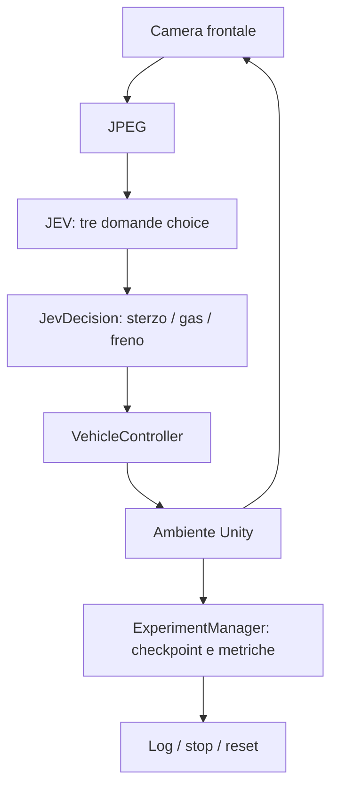

# JEV Vision Lab

Prototipo Unity di guida su circuito chiuso: **l'unico controllo autonomo è JEV**, che riceve esclusivamente il JPEG della camera frontale e restituisce sterzo, acceleratore e freno. Resta disponibile il controllo manuale per verificare fisica e pista. Il precedente algoritmo basato sui colori è stato eliminato dal progetto il 28 ottobre 2026.

Versioni: **Unity 6000.3.26f1**, URP 17.3.0, Input System 1.20.0.

## Avvio

1. Aprire questa cartella (`My project`) con Unity Hub.
2. Aprire `Assets/Scenes/JevVisionCircuit.unity`.
3. Configurare `TYPESAFE_API_KEY` con `scripts/set-jev-key.ps1`.
4. Premere **Play** nell'editor: appare la schermata **Prepara la guida**, con auto bloccata e zero richieste API.
5. Scegliere **Manuale** o **JEV Vision**, la **velocità massima** (0,5–8 m/s, con conversione in km/h) e, per JEV, la **frequenza richiesta** (0,2–10 call/s). Slider e campi numerici accettano anche valori decimali con virgola.
6. Premere **PLAY · AVVIA GUIDA** dentro il gioco. In manuale usare W/A/S/D o frecce; in JEV iniziano le richieste API, che possono consumare credito. Senza una chiave valida il veicolo resta frenato.

Le impostazioni si applicano alla sessione e vengono salvate nel suo `config.json`, senza modificare l'asset del progetto. Prima di Play, neppure i tasti P, 1/2 o l'acceleratore avviano la guida. Il cronometro parte con la guida e si ferma durante le pause. La frequenza è un massimo: c'è sempre una sola richiesta in volo. Per intervalli lunghi la validità del comando è almeno l'intervallo tra chiamate più 0,5 s.

Il player Windows è `Builds/Windows/JevVisionLab.exe`. Per avviarlo: `powershell -ExecutionPolicy Bypass -File scripts/play.ps1`. Il parametro `-Mode manual` permette di guidare senza API. La build è rigenerabile con **JEV Vision > Build Windows player and validate**.

Il circuito misto di circa 482 m riprende il [perimetro dell'utente](Documentation/Circuit-reference.png), con carreggiata di 12 m e curve in entrambe le direzioni. Le cinque mesh continue della strada sono generate in `Assets/JevVision/Generated`; barriere e auto usano primitive. **Create or rebuild circuit scene** rigenera strada, partenza e checkpoint insieme. Una firma impedisce di guidare una scena non coerente con la spline di valutazione. [Dettagli](Documentation/Circuit.md).

Le barriere sono **blu e alte 1,5 m**, con base a terra (in precedenza 0,9 m). Colore e altezza sono salvati nella scena e nel materiale `Rail`, e riportati nel generatore: una futura rigenerazione conserva questi valori.

All'avvio vengono aggiunti alberi low poly fuori strada, nel gruppo `Roadside low poly trees`: tronchi semplici e chiome coniche a sei lati, due tonalità di verde e dimensioni variabili. Una distribuzione deterministica mantiene alberi e chiome oltre le barriere, controllando la distanza da tutto il circuito. Sono elementi visivi senza collider, visibili anche alla camera JEV. Non aggiungono campi al payload.

Le strisce gialle centrali sono lunghe 1,6 m e si ripetono ogni **4 m** (in precedenza 8 m): frequenza raddoppiata e spazio vuoto fra le strisce ridotto a 2,4 m. Anche le scene salvate prima della modifica aggiornano le strisce automaticamente all'avvio della guida.

## Modalità e tastiera

| Comando | Azione |
|---|---|
| 1 | Manuale, senza API |
| 2 | JEV Vision (anche 3 per compatibilità con i vecchi comandi) |
| W / freccia su | Acceleratore manuale |
| A-D / frecce laterali | Sterzo manuale |
| S / freccia giù / Spazio | Freno manuale |
| P | Pausa/riprendi i comandi |
| R | Reset del tentativo |
| C | Vista osservatore: inseguimento / panoramica |

Durante la guida i pulsanti dell'HUD replicano modalità, pausa e reset; mostrano anche velocità massima e frequenza impostate. Non esiste una modalità automatica offline o un fallback al controllo a colori.

Il pannello **DECISIONI JEV**, sempre visibile in alto a destra durante la guida, mostra in grande sterzo, gas e freno restituiti dal modello. Indica se la decisione è applicata, in attesa, scaduta o sospesa; in manuale non presenta comandi JEV come attivi. L'anteprima del JPEG e il dettaglio della risposta sono sotto il pannello, se il debug overlay è abilitato.

## Credenziali

Eseguire sul computer: `powershell -ExecutionPolicy Bypass -File scripts/set-jev-key.ps1`. L'inserimento è nascosto. Lo script salva la chiave nella variabile d'ambiente utente **TYPESAFE_API_KEY**, nel registro Windows `HKEY_CURRENT_USER\Environment`, fuori dal repository. È persistente e non è un archivio cifrato di segreti.

`JevClient` legge la variabile del processo oppure quella utente Windows. La chiave viene inviata solo nell'header Authorization all'endpoint HTTPS configurato; non è contenuta nei frame, nel JSON della richiesta, nell'Inspector o nei log. Per sostituirla rieseguire lo script. Per rimuoverla: `[Environment]::SetEnvironmentVariable('TYPESAFE_API_KEY', $null, 'User')`.

Il player è destinato all'uso desktop locale; per distribuire il software a terzi custodire la chiave su un backend. [Contratto e fonti JEV](Documentation/JEV-API.md).

## Parametri

Selezionare `Assets/JevVision/Resources/ExperimentSettings.asset`.

| Parametro | Valore iniziale |
|---|---|
| Start Mode | JevVision |
| Maximum Speed | 1,2 m/s, configurabile |
| Decisions Per Second | 2 Hz massimi, una sola richiesta in volo |
| Maximum Steering Degrees | 24 gradi |
| Throttle Scale | 0,7 |
| Frame | JPEG 280 x 280, qualità 80 |
| Camera | FOV 65 gradi, altezza 1,5 m, pitch 8 gradi |
| Timeout | 8 s |
| Maximum Decision Age | 2 s dall'acquisizione, poi frenata |
| Model | jev-1.14.0 |
| Maximum API Calls Per Session | 600 |
| Maximum Estimated Cost USD | 0,05 |
| Attempt Timeout | 600 s |

Risoluzione, JPEG, frequenza, velocità, sterzo, timeout, età massima del comando, budget e logging sono configurabili. Per cambiare la posa/FOV della camera o i checkpoint rigenerare la scena. I parametri del vecchio algoritmo a colori sono stati rimossi.

La fisica usa un Rigidbody e un modello dinamico a bicicletta: accelerazione, freno, attrito laterale e contatti reali con le barriere. Rollio/beccheggio sono vincolati per la stabilità V1; non si simula una sospensione realistica.

## Architettura e vincolo visual-only



| Componente | Compito |
|---|---|
| VehicleController | Motore fisico, sterzo, freno e limite di velocità |
| CameraCapture | RenderTexture frontale, richiesta URP esplicita, JPEG e timestamp |
| JevProtocol / JevClient | Schema ufficiale, HTTP asincrono e parsing |
| JevDecision | Sette etichette di sterzo, acceleratore e freno |
| AutonomousController | Manuale oppure JEV, scheduling, scarto risposte vecchie, budget |
| ExperimentManager / LapCheckpoint | Valutazione indipendente, giri e reset |
| TelemetryLogger / TelemetryHud | CSV/JSONL, frame, richieste, risposte e HUD |
| SceneFactory / ProjectTools | Costruzione deterministica e verifica della scena |
| RuntimeValidation | Prove riproducibili nel player |

Il solo input dinamico di `JevProtocol.BuildRequest(byte[] jpeg, string model)` è il JPEG. `state` contiene `camera` e un'istruzione statica; le tre domande condividono lo stesso frame. Il compito e la domanda sullo sterzo indicano la linea gialla tratteggiata come traiettoria: considerare più tratteggi consecutivi, anticipare la curvatura e sterzare dolcemente, usando i bordi se le strisce non sono chiare. Gas e tutte le etichette di risposta restano originali. Il criterio del freno chiede esplicitamente di frenare prima del contatto se la traiettoria visibile porta verso la barriera blu/azzurra o un altro ostacolo. L'invio dello stato dell'auto e le istruzioni relative a velocità, sterzo e rotazione sono stati rimossi su richiesta dell'utente. Non vengono passati posizione, velocità, waypoint, distanze, raycast, geometria o checkpoint. L'HUD e i trigger invisibili non compaiono nella camera del modello. La telemetria locale resta disponibile per HUD e log.

Le risposte JEV sono l'unica sorgente di comandi automatici. La fisica usa il Rigidbody per applicarli; l'evaluator può interrompere o resettare un tentativo ma non corregge lo sterzo. Cambio modalità e reset invalidano le risposte pendenti. Il vecchio valore serializzato della modalità rimossa viene convertito in Manuale.

## API e guasti

JEV usa `POST https://api.typesafe.ai/v1/systemone`, Bearer authentication e l'header sperimentale `TypeSafe-Danger-Zone-Images: true`. Il JSON contiene un asset JPEG base64 con UUID referenziato in `state.camera`.

Tre domande `choice`: sterzo, accelerazione (`coast`, `slow`, `cruise`) e freno (`release`, `apply`). Il freno annulla il gas. La confidence mostrata è il minimo delle tre confidence quando tutte presenti; le distribuzioni restano nella risposta grezza. La frequenza reale dipende dalla latenza: non vengono accumulate richieste arretrate.

Durante l'attesa rimane l'ultimo comando valido, entro l'età massima del frame. Dopo la scadenza si frena. Timeout, parsing invalido, risposte obsolete e budget esaurito non avviano altri metodi di guida. Gli errori temporanei applicano backoff e Retry-After; quelli permanenti sospendono le richieste fino alla riselezione della modalità.

## Valutazione

Un giro richiede i 16 checkpoint nell'ordine 1...15,0 e nel verso corretto. I contatori JEV/manuale richiedono modalità invariata e nessuna pausa/reset nel giro. Reset per uscita pista persistente, contatto grave con una barriera, posa invalida/ribaltamento, blocco o timeout. In manuale il controllo di blocco richiede che si stia tentando di accelerare. Senza chiave non vengono ripetuti reset da fermo. Dopo il budget di reset l'esperimento si mette in pausa.

## Log e costi

Ogni sessione ha una cartella UTC univoca in `%USERPROFILE%/AppData/LocalLow/JevVisionLab/JEV Vision Lab/Runs/`, oppure nell'Output Directory configurata. Le prove scrivono in `Validation/Runs/`.

- `config.json`: parametri, senza chiave.
- `telemetry.csv`: campioni a 5 Hz, comandi, velocità, confidence, API, latenze, token, costi, reset, giri e metriche di valutazione.
- `decisions.jsonl`: decisione, timestamp di cattura/ricezione, esito applicazione/scarto, risposta grezza, HTTP, token ed errori.
- `frames/*.jpg`: JPEG associato a ogni decisione, se abilitato.
- `requests/*.json`: JSON realmente inviato, senza header Authorization o chiave.
- `events.csv`: checkpoint, reset, modalità, pause e giri.
- `report.json`, `front-final.jpg`, `overview-final.png`, `circuit-plan.png`: risultati delle prove.

CSV con virgole, decimali con punto, stringhe quotate e timestamp UTC ISO-8601. Confidence -1 significa assente. Tariffa centralizzata nell'asset, verificata il 28 ottobre 2026: input $0,042 per milione di token, output gratuiti. Gli input token includono le immagini. Le stime usano esclusivamente usage effettivamente riportato; un utilizzo mancante è segnalato. I tassi sono medie di sessione; il costo per giro JEV include anche tentativi non riusciti della sessione. Il budget stimato non sostituisce i limiti del conto del provider.

## Prove riproducibili

`JEV Vision > Build Windows player and validate` compila ed esegue i controlli di protocollo, modalità e geometria. Da editor chiuso si può usare `Unity.exe -batchmode -projectPath "<progetto>" -executeMethod JevVision.Editor.ProjectTools.BuildAndValidate -logFile "<log>"`.

```powershell
powershell -ExecutionPolicy Bypass -File scripts/validate.ps1 -Test manual
powershell -ExecutionPolicy Bypass -File scripts/validate.ps1 -Test setup
powershell -ExecutionPolicy Bypass -File scripts/validate.ps1 -Test frame
powershell -ExecutionPolicy Bypass -File scripts/validate.ps1 -Test resets
powershell -ExecutionPolicy Bypass -File scripts/validate.ps1 -Test no-key
powershell -ExecutionPolicy Bypass -File scripts/validate.ps1 -Test jev-frame
powershell -ExecutionPolicy Bypass -File scripts/validate.ps1 -Test jev-smoke
```

I test `setup`, `manual`, `frame`, `resets` e `no-key` non chiamano API. `setup` verifica auto bloccata e zero chiamate prima di Play, nessun avvio tramite scorciatoie, applicazione di modalità/frequenza/velocità e rispetto del limite di 0,8 m/s nella guida manuale. I test automatici avviano esplicitamente la guida; l'apertura normale del player passa sempre dalla schermata iniziale. `no-key` usa un nome di variabile inesistente per il solo processo, senza toccare la chiave dell'utente. `jev-frame` esegue al massimo una richiesta con la camera reale e veicolo bloccato. `jev-smoke` usa soltanto le decisioni JEV, al massimo 12 richieste e velocità limitata a 1 m/s. `-Test jev` tenta un giro e può consumare l'intero budget configurato. `scripts/test-jev-text.ps1` è il test curl testuale separato.

Non usare `-nographics`: le prove richiedono rendering reale. I report del 25 ottobre in `Validation/Evidence` e `Validation/CircuitEvidence` sono archivi storici e non dimostrano un giro guidato da JEV. Stato e risultati attuali sono in `Validation/RESULTS.md`.

## Troubleshooting e limiti

- Senza chiave o con risposta non valida l'auto resta frenata. Controllare lo stato API nell'HUD.
- Dopo 401/402/403 correggere chiave o credito e riselezionare JEV. Per 429 consultare i limiti della propria organizzazione.
- Se le risposte arrivano troppo tardi, controllare frame, latenza ed età massima del comando; regolare velocità e frequenza con sessioni nuove.
- Entrambi i lati dell'immagine devono essere fra 280 e 1568 pixel. La cattura effettua rendering URP esplicito anche nei player batch.
- Per la tastiera mettere il focus nella Game view. Il progetto usa il nuovo Input System.
- Se appare Scena da rigenerare, usare il menu di ricostruzione e riavviare Play.
- Le immagini JEV sono sperimentali. Una chiamata valida non dimostra che il modello sappia guidare o completare il giro: questi risultati vanno misurati nei log.
