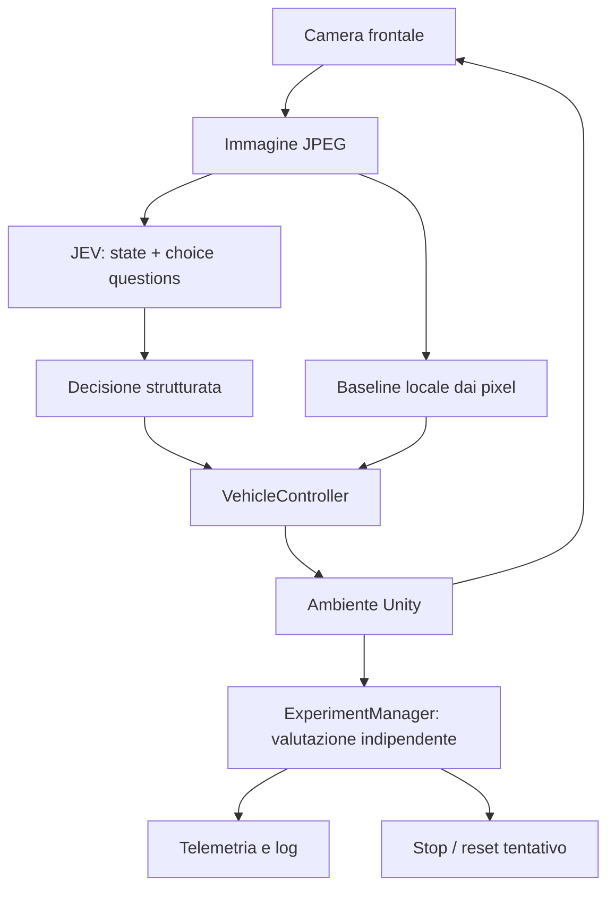

# JEV Vision Lab

Prototipo Unity di guida su circuito chiuso con camera frontale, tre modalità, valutazione indipendente e log riproducibili. Versione del progetto: **Unity 6000.3.26f1**, Universal Render Pipeline 17.3.0, Input System 1.20.0.

La modalità predefinita **Local Vision** funziona senza account o rete: un algoritmo semplice legge i pixel della camera e segue l'asfalto. **JEV Vision** integra il contratto multimodale sperimentale ufficiale TypeSafe e richiede una chiave. I risultati delle due modalità sono separati: un giro locale non dimostra che JEV sappia guidare.

## Avvio immediato

1. Aprire questa cartella (`My project`) in Unity Hub con Unity 6000.3.26f1.
2. Aprire `Assets/Scenes/JevVisionCircuit.unity` e premere **Play**.
3. L'auto parte in **Local Vision**. Si possono osservare camera effettiva, comandi, checkpoint e giri nel pannello.

È incluso anche il player Windows in `Builds/Windows/JevVisionLab.exe` quando la compilazione è disponibile. Avviarlo con doppio clic oppure `powershell -ExecutionPolicy Bypass -File scripts/play.ps1`. Per ricrearlo: **JEV Vision → Build Windows player and validate** nell'editor.

La scena è costruita con primitive e materiali locali, senza download di asset. **JEV Vision → Create or rebuild circuit scene** la rigenera in modo deterministico; la rigenerazione sostituisce la scena del prototipo. `SampleScene.unity` originale resta disponibile.

## Comandi

| Tasto | Azione |
|---|---|
| 1 | Manuale |
| 2 | Local Vision dai pixel, zero chiamate API |
| 3 | JEV Vision con API |
| W / freccia su | Acceleratore manuale |
| A-D / frecce sinistra-destra | Sterzo manuale |
| S / freccia giù / Spazio | Freno manuale |
| R | Reset al punto iniziale |
| P | Pausa/riprendi comandi |
| C | Camera osservatore: inseguimento / panoramica |

I pulsanti a schermo replicano le scelte di modalità, pausa e reset. La camera osservatore serve a guardare l'esperimento; il sensore resta la camera frontale sull'auto.

## Configurazione

Selezionare `Assets/JevVision/Resources/ExperimentSettings.asset` nell'Inspector. I componenti condividono questo asset.

| Parametro | Valore iniziale / significato |
|---|---|
| Start Mode | LocalVision |
| Decisions Per Second | 2 Hz, massimo una richiesta in volo |
| Maximum Speed | 2,2 m/s (7,9 km/h) |
| Maximum Steering Degrees | 24° |
| Throttle Scale | 0,7 per manuale/JEV |
| Image Width / Height | 280×280, minimo imposto dall'API |
| JPEG Quality | 80 |
| Field Of View | 65° |
| Camera Height / Pitch | 1,5 m / 8° verso il basso |
| Timeout Seconds | 8 s |
| Maximum Decision Age Seconds | 2 s dalla cattura |
| Maximum Api Calls Per Session | 240 |
| Maximum Estimated Cost Usd | 0,05 |
| Save Decision Frames | Salva JPEG associato a ogni decisione |
| Output Directory | Vuoto: cartella dati del player; personalizzabile |

Per cambiare posizione/FOV della camera nella scena già generata modificare la camera frontale e i corrispondenti parametri di calibrazione, oppure modificare i parametri e rigenerare la scena dal menu. I parametri della pista e il numero dei checkpoint richiedono rigenerazione. Per le prove comparabili iniziare una nuova sessione dopo modifiche alla configurazione.

La fisica usa un **Rigidbody con modello dinamico a bicicletta**, accelerazione, frenata, attrito laterale e contatti reali con le barriere. Il limite di velocità è locale al motore. Le ruote visive anteriori sterzano. Rollio e beccheggio sono vincolati per la stabilità V1; la gestione del ribaltamento resta presente e viene verificata forzando una posa invalida. La sospensione e gli pneumatici realistici non sono simulati.

## Attivare JEV successivamente

1. Ottenere una chiave nella [console TypeSafe](https://console.typesafe.ai/).
2. Eseguire localmente `powershell -ExecutionPolicy Bypass -File scripts/set-jev-key.ps1`: la richiesta della chiave è nascosta e viene salvata nella variabile utente **TYPESAFE_API_KEY**, fuori dal progetto.
3. Avviare il prototipo e premere **3**. In assenza di chiave l'auto rimane frenata e l'HUD mostra la variabile mancante.

Il client cerca prima la variabile del processo e poi quella utente Windows, così si può impostare la chiave anche dopo l'apertura dell'editor. Per sostituirla rieseguire lo script. Per rimuoverla: `[Environment]::SetEnvironmentVariable('TYPESAFE_API_KEY', $null, 'User')`. Non mettere credenziali in script, Inspector, README, screenshot o repository. Il nome della variabile, endpoint e modello sono configurabili.

Il client è destinato al desktop locale dell'utente. Per distribuire un gioco a terzi usare un backend che custodisca la chiave; non compilare segreti nel player. Nessuna credenziale è inclusa nel progetto.

Specifiche, fonti, prezzi e limiti sono descritti in [Documentation/JEV-API.md](Documentation/JEV-API.md).

## Architettura



| Componente | Compito |
|---|---|
| VehicleController | Rigidbody, accelerazione, sterzo, freno, limite velocità |
| CameraCapture | RenderTexture frontale, readback, JPEG, timestamp |
| JevProtocol / JevClient | Contratto ufficiale, HTTP asincrono, parsing rigoroso |
| JevDecision | Comandi e mapping delle sette etichette di sterzo |
| AutonomousController | Modalità, richieste seriali, validità temporale, budget |
| LocalVisionDriver | Baseline visiva offline, puro input pixel/calibrazione |
| TrackLayout / LapCheckpoint | Geometria e checkpoint di valutazione |
| ExperimentManager | Giri, progresso, reset, metriche |
| TelemetryLogger / TelemetryHud | CSV/JSONL, metriche e debug a schermo |
| SceneFactory / ProjectTools | Scena deterministica e build |
| RuntimeValidation | Prove del player e report quantitativi |

## Vincolo visual-only

Il corpo dinamico della richiesta JEV contiene **solo il JPEG della camera**. Il resto è modello, istruzioni statiche e opzioni; non sono serializzati transform, velocità, geometria, waypoint, raycast, checkpoint o errori dalla linea centrale. `JevProtocol.BuildRequest` accetta unicamente `byte[] jpeg` e `string model`.

La baseline locale riceve `Texture2D` e calibrazione/configurazione fissa: cerca una fascia d'asfalto nel frame, ne stima il centro e converte il punto visibile in sterzo usando la proiezione della camera. La scelta si basa sui pixel. Non legge posizione o direzione ideale del circuito. È adatta al circuito pulito di questo prototipo, non equivale a un VLM generalista.

I checkpoint invisibili e la distanza dalla strada sono esclusivi dell'evaluator. Quest'ultimo può interrompere e resettare un tentativo, ma non corregge lo sterzo. Reset o cambio modalità invalidano i comandi e le risposte HTTP del tentativo precedente. I comandi manuali e le iniezioni delle prove automatiche sono esplicitamente separati e non vengono registrati come guida JEV.

## Valutazione e reset

Sedici trigger invisibili devono essere attraversati **nell'ordine 1…15,0 e nel verso corretto**. La partenza dentro il trigger 0 non assegna un giro. Nessun checkpoint influenza i comandi. I contatori dedicati locale/JEV/manuale richiedono modalità invariata e assenza di pause/reset nel giro; un giro misto resta visibile nel totale e negli eventi.

Reset per uscita oltre la strada con tolleranza e durata configurabili, contatto grave con barriera, posa ribaltata/invalida, assenza di progresso, timeout del tentativo. In modalità manuale non si resetta solo perché l'utente resta fermo. Senza chiave JEV non si ripete inutilmente il reset da fermo. Dopo 20 reset automatici l'esperimento si mette in pausa. R permette un reset esplicito.

## Log e debug

Ogni sessione ha una cartella UTC univoca. Destinazione predefinita Windows:

`%USERPROFILE%/AppData/LocalLow/JevVisionLab/JEV Vision Lab/Runs/`

I test scrivono invece in `Validation/Runs/`. La destinazione effettiva compare nel log Unity come `JEV_VISION_LOGS`.

- `config.json`: snapshot dei parametri, senza chiave.
- `telemetry.csv`: campioni a 5 Hz; velocità, comando, confidence, stato API, latenza, token, stime di costo, tentativi, reset, giri e metriche riservate alla valutazione.
- `decisions.jsonl`: timestamp di cattura/ricezione, modalità, decisione interpretata, risposta grezza completa incluse probabilità, utilizzo, HTTP, errori, esito di applicazione/scarto e file del frame.
- `events.csv`: checkpoint, cambio modalità, pause, reset e giri.
- `frames/*.jpg`: bytes JPEG effettivamente associati a ogni decisione (se abilitato).
- `report.json`, `front-final.jpg`, `overview-final.png`: output delle validazioni automatiche.

CSV usa virgole, decimali con punto, stringhe tra virgolette, UTC ISO-8601. `confidence=-1` indica dato assente; costo per giro JEV vuoto indica nessun giro JEV. Gli importi sono USD stimati. L'HUD non viene mai incorporato nella RenderTexture frontale.

## Collaudo e riproducibilità

**JEV Vision → Run protocol and isolation checks** verifica schema, etichette, frenata, campi esclusi dal payload, frame sintetici e scena. **Build Windows player and validate** esegue anche questi controlli prima della build. Risultati in `Validation/protocol-checks.json` e `Validation/build-result.txt`.

Dopo la build:

```powershell
powershell -ExecutionPolicy Bypass -File scripts/validate.ps1 -Test manual
powershell -ExecutionPolicy Bypass -File scripts/validate.ps1 -Test resets
powershell -ExecutionPolicy Bypass -File scripts/validate.ps1 -Test lap
```

Il test manuale invia eventi di tastiera al nuovo Input System e misura accelerazione, variazione d'orientamento e arresto. Il test reset induce uscita pista, ribaltamento e blocco. Il test lap usa la baseline reale dai pixel con rendering attivo, non una traiettoria precalcolata. `no-key` verifica la frenata senza credenziale solo se la variabile è assente: non usarlo su un ambiente già configurato con una chiave.

Per batch da editor chiuso: `Unity.exe -batchmode -projectPath "<questa cartella>" -executeMethod JevVision.Editor.ProjectTools.BuildAndValidate -logFile "<log>"`. Non usare `-nographics` per le prove di camera. Se l'editor è già aperto usare il menu: Unity non può aprire due editor sullo stesso progetto. Un bridge locale esegue la stessa build quando esiste `Validation/build.request` e scrive `editor-build-status.txt`.

Le misure effettive e lo stato delle milestone sono riportati in [Validation/RESULTS.md](Validation/RESULTS.md). La compilazione da sola non è considerata prova del completamento del giro.

## Costi

Modalità locale/manuale: nessun utilizzo API. In JEV i prezzi sono centralizzati nell'asset: input $0,042/M token e output $0/M, verificati sulle fonti ufficiali il 25 ottobre 2026. I token immagini dipendono dal servizio e vanno misurati nelle risposte. Chiamate/minuto, token/minuto e costo/minuto sono medie di sessione; costo/ora è un'estrapolazione di quella media. Il costo per giro JEV include anche i tentativi non riusciti della sessione. Non si attribuisce un costo per giro JEV ai giri della baseline.

## Limiti e troubleshooting

- **JEV non parte:** controllare `TYPESAFE_API_KEY`, selezionare 3; nessun fallback silenzioso alla baseline. 401 indica credenziale, 402 credito, 429 limite organizzazione. Dopo errori permanenti correggere e riselezionare 3.
- **JEV frena durante l'attesa:** guardare latenza e `maximumDecisionAgeSeconds`; ridurre velocità, usare frame minimi e modificare con criterio l'età massima. La latenza reale può impedire 2 Hz.
- **Immagine rifiutata:** entrambi i lati devono essere almeno 280 e al massimo 1568, header immagini abilitato, JPEG/PNG valido.
- **Tastiera inattiva:** mettere il focus nella Game view; usare Input System del template, non Legacy Input Manager.
- **Camera nera:** eseguire con rendering disponibile, senza `-nographics`. La cattura usa una richiesta URP esplicita anche nel player batch, dove le camere non vengono renderizzate automaticamente. La validazione controlla anche che il frame abbia contenuto visivo.
- **Modifiche camera/config:** rigenerare la scena per applicare la posa/FOV fissi; per il confronto dei parametri usare sessioni nuove.
- **Baseline perde la strada:** controllare illuminazione/materiali e il frame registrato; agisce su asfalto quasi grigio e può fallire con ombre, texture e ostacoli nuovi. Non è un sistema stradale reale.
- **Log assenti:** vedere l'errore logging nell'HUD, verificare permessi e spazio nella cartella configurata.
- **Build bloccata da editor aperto:** usare il menu o il bridge locale; non cancellare il lock di un progetto in uso.

Il giro locale è una verifica del prototipo. M4–M6 e M8–M9 riferite a JEV richiedono credenziali, prove e possibili iterazioni su velocità, frequenza, camera, prompt e sterzo. Le capacità sperimentali del modello non garantiscono il risultato.
