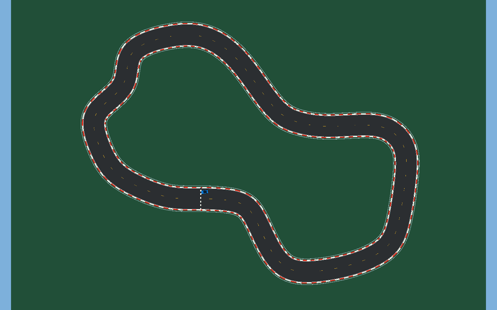
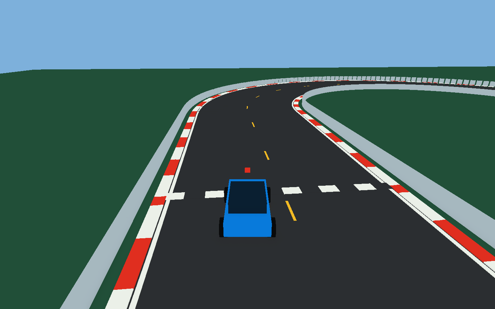

# Historical validation — October 25, 2026

> Archived evidence. These tests used the color-based autonomous controller removed on October 28, 2026. Its completed laps are not JEV results. See [RESULTS.md](RESULTS.md) for current behavior and verification limits. This English edition preserves the original measurements and distinguishes the original oval from the later mixed circuit.

## Mixed circuit and startup mismatch fix

The replacement circuit followed the supplied outline and measured **482.47 m**. The player completed a local-controller lap in **229.45 s**, with **455 pixel-based decisions**, **0 resets**, and **0 API calls**. Centerline RMS error was **2.45 m**, with a **4.70 m** maximum on a 12 m road. All checkpoints were crossed in order. Manual, reset, and missing-key tests passed.

That build had **0 errors and 0 warnings** and passed **187 checks**, including negative cases changing road width and spline points without regenerating geometry. Logs contained 82 left and 265 right decisions at a normalized steering threshold of ±0.05.

The reported startup bug came from a saved oval scene paired with evaluator scripts already using the new spline. Logs showed a **24.03 m** initial centerline error and a reset to the wrong circuit's start point. Road, vehicle, and checkpoints were regenerated together, and a geometry signature was added to prevent driving a stale scene. See the [circuit guide](../Documentation/Circuit.md).

Mixed-circuit evidence is in [CircuitEvidence](CircuitEvidence/). The `Evidence/` files and the oval measurements below describe the earlier track. `final-summary.json` is a historical summary file and should be interpreted alongside the corresponding reports, rather than as current validation status.



## Original oval: environment and scope

Environment: Windows 11, Unity 6000.3.26f1, URP 17.3.0, a Windows player with Direct3D rendering, and an NVIDIA RTX 3050 Laptop GPU. Tests ran in the compiled player on the project owner's machine.

At this stage the requested prototype operated **without JEV or credentials**, while preparing later API integration. The tested **Local Vision** controller consumed real camera pixels. No lap was attributed to JEV, and no service requests were made.

## Original build and checks

- Windows build succeeded with **0 errors and 0 warnings**.
- The initial stage passed **52 checks** covering seven steering labels, invalid responses, the then-existing brake override, image-asset format, exclusion of privileged driving input, synthetic-image behavior, circuit closure, and invisible checkpoints.
- JEV responses used in those checks were fixtures, not real API responses.

Build/check artifact names were reused in later work. Current `build-result.txt` and `protocol-checks.json` must therefore not be assumed to be immutable copies of this initial 52-check run.

## Original player tests

| Test | Historical result |
|---|---|
| Manual input through Input System keyboard events | 2.2 m/s, approximately 39° rotation, braking to 0 m/s |
| Camera and initial local decisions | 20 decisions in 10 s; nonempty 280 × 280 JPEG; acceleration to 2.2 m/s |
| Automatic resets | Off-track, rollover, and stuck conditions caused distinct resets; the stuck timeout was shortened to 2 s only for the test |
| JEV without a key | Stationary vehicle, no pointless reset loop, **0 API calls** |
| Local Vision lap | All checkpoints `1 ... 15, 0`, with no intervention, resets, or API calls |

Selected final reports were copied to [Evidence](Evidence/). Original local session directories were kept outside the published evidence set.

The final oval lap took **108.51 s**, with **215 local decisions**, **0 resets**, **0 API calls**, **2.33 m RMS** centerline error, and **3.33 m maximum** error. The checkpoint sequence is in [lap-events.csv](Evidence/lap-events.csv), controls and samples in [lap-telemetry.csv](Evidence/lap-telemetry.csv) and [lap-decisions.jsonl](Evidence/lap-decisions.jsonl), and the final report in [lap-report.json](Evidence/lap-report.json).



## Relevant iterations

The first batch test produced black camera frames. The local controller applied its then-existing brake command, and the lap failed. Capture was corrected using `RenderPipeline.SubmitRenderRequest` and `UniversalRenderPipeline.SingleCameraRequest`, checked against the installed URP source. Validation was extended to require pixel variation rather than just an existing JPEG.

The first lap after the rendering fix took **108.49 s**, with no resets, 216 decisions, and **2.34 m RMS** centerline error. Images then revealed small gaps between curved primitive road segments. Segment overlap was increased and the final surface was tested again, producing the 108.51-second result above.

## Camera-only separation at that stage

The historical control path was:

```text
Camera JPEG → LocalVisionDriver or JevClient → JevDecision → VehicleController
```

`LocalVisionDriver.Decide` used pixels and fixed camera calibration. `JevProtocol.BuildRequest` accepted JPEG bytes and a model identifier. Neither decision path read track layout, evaluator state, waypoints, or raycasts. The evaluator measured distance and checkpoints and could stop/reset attempts, but could not choose steering or throttle. Resets invalidated earlier responses.

Vehicle physics used Rigidbody velocity to apply acceleration, the then-existing braking force, lateral damping, and steering. That velocity was not supplied to the model. Pixel projection in the local baseline assumed flat ground and known camera calibration rather than reading the car's engine-side position or orientation.

`LocalVisionDriver` and the old braking control are no longer part of the current implementation. Their names here describe historical evidence only.

## Original milestones

| Milestone | Status on October 25 |
|---|---|
| M1 Scene and circuit | Exercised in the player |
| M2 Manual control | Verified through Input System keyboard events |
| M3 Camera | Frames rendered, compressed, saved, and inspected |
| M4 Image request to JEV | Prepared, not executed without a key |
| M5 Structured response | Fixture parser checks only; real response still pending |
| M6 JEV controls the car | Prepared, awaiting credentials |
| M7 Telemetry and resets | Verified offline |
| M8 Lap attempt | Completed with Local Vision; JEV not yet tested |
| M9 Completed lap | Achieved with Local Vision only |

## Limits

The environment used a wide road and stable colors. The baseline was not tested on different circuits, weather, textures, or variable obstacles. JEV latency, tokens, and cost were not measured at this stage. Later JEV experiments are recorded in [HISTORY-2026-10-28.md](HISTORY-2026-10-28.md), and current status is in [RESULTS.md](RESULTS.md).
