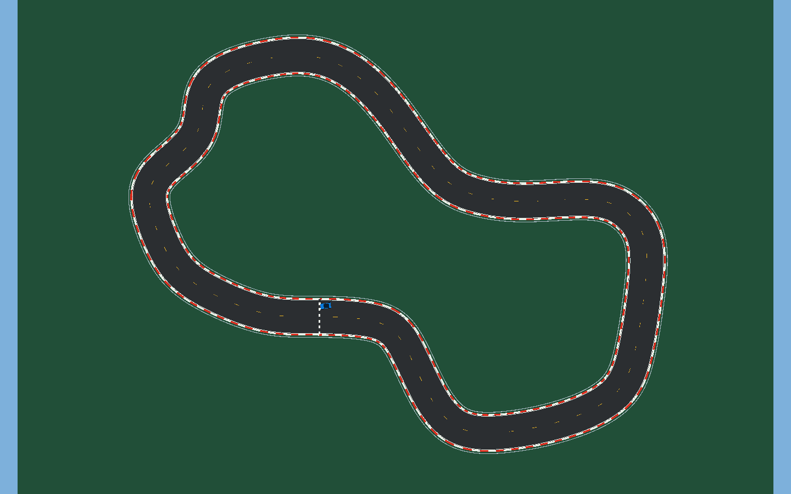
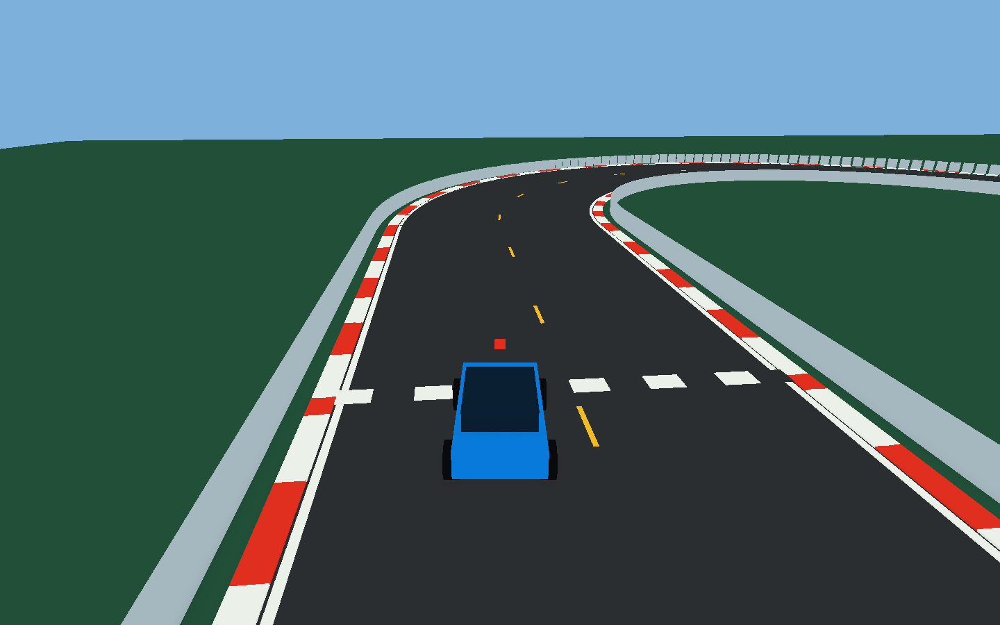

# Verifiche del prototipo — 25 ottobre 2026

## Aggiornamento: circuito misto e difetto di partenza corretto

La scena attuale riprende il perimetro dell'utente ed è lunga **482,47 m**. Il player ha completato un giro locale in **229,45 s**, con **455 decisioni dai pixel**, **0 reset** e **0 chiamate API**. Errore RMS dalla linea centrale **2,45 m**, massimo **4,70 m**, su carreggiata larga 12 m. Sono stati attraversati tutti i checkpoint in ordine; gli esiti dei test manuale, reset e assenza di chiave sono PASS. La build finale ha **0 errori e 0 avvisi**; passano **187 controlli**, inclusi i casi che modificano larghezza e spline senza rigenerare la geometria. I log contengono 82 decisioni a sinistra e 265 a destra (soglia di sterzo ±0,05).

Report e log della nuova pista: `CircuitEvidence/`. Il riepilogo attuale è `final-summary.json`. I risultati in `Evidence/` e nelle sezioni storiche qui sotto riguardano l'ovale iniziale.

Il difetto segnalato dall'utente era una scena ovale salvata con script di valutazione già aggiornati alla spline: i log mostravano 24,03 m di errore alla partenza e un reset nel punto iniziale del circuito sbagliato. Sono stati rigenerati insieme strada, auto e checkpoint. Un controllo della firma della geometria ora impedisce di guidare una scena non aggiornata. Dettagli in `Documentation/Circuit.md`.

## Risultati storici dell'ovale iniziale

Ambiente: Windows 11, Unity 6000.3.26f1, URP 17.3.0, player Windows con rendering Direct3D e GPU NVIDIA RTX 3050 Laptop. Le prove sono state eseguite nel player compilato sul progetto dell'utente.

## Ambito del risultato

Su richiesta dell'utente il prototipo deve funzionare **senza JEV e senza credenziali**, mantenendo pronta l'integrazione successiva. La guida provata è quindi **Local Vision**, alimentata dai pixel reali della camera. Nessun giro locale è attribuito a JEV; non sono state effettuate richieste al servizio.

## Build e controlli

- Build Windows riuscita, **0 errori e 0 avvisi**: `build-result.txt`.
- **52 controlli superati**: `protocol-checks.json`. Comprendono parsing delle sette etichette, risposte invalide, precedenza del freno, formato degli asset immagine, esclusione di informazioni privilegiate, comportamento su immagini sintetiche, circuito chiuso e checkpoint invisibili.
- Le risposte JEV di questi controlli sono fixture; non dimostrano una chiamata reale.

## Prove nel player

| Prova | Esito verificato |
|---|---|
| Manuale tramite eventi del nuovo Input System | Velocità 2,2 m/s, rotazione circa 39°, frenata fino a 0 m/s |
| Camera e primi comandi locali | 20 decisioni in 10 s, JPEG 280×280 con contenuto visivo, accelerazione a 2,2 m/s |
| Reset automatici | Uscita pista, ribaltamento e blocco inducono tre reset distinti; tempo blocco ridotto a 2 s esclusivamente nel test |
| JEV senza chiave | Veicolo fermo, nessun reset inutile, **0 chiamate API** |
| Giro Local Vision | Un giro completo attraverso 1…15,0, senza interventi, senza reset, senza API |

I report e i file originali si trovano nelle cartelle di sessione sotto `Runs/`; i report conclusivi sono raccolti anche in `Evidence/`.

**Giro sulla build finale:** **108,51 s**, **215 decisioni locali**, **0 reset**, **0 chiamate API**, errore RMS **2,33 m**, errore massimo **3,33 m** su strada larga 12 m. La sequenza completa dei checkpoint è presente in `Evidence/lap-events.csv`; i campioni fisici e i comandi sono in `Evidence/lap-telemetry.csv` e `Evidence/lap-decisions.jsonl`. Il report è `Evidence/lap-report.json`; `final-summary.json` raccoglie tutte le prove superate.

## Iterazioni rilevanti

La prima prova batch ha prodotto frame neri: il driver ha frenato e il giro è fallito. È stato corretto il percorso di cattura usando `RenderPipeline.SubmitRenderRequest` e `UniversalRenderPipeline.SingleCameraRequest`, verificati nei sorgenti URP installati. La validazione ora controlla la variazione dei pixel, oltre alla presenza del JPEG, così un frame nero non passa.

La prima prova con rendering corretto ha completato il giro in **108,49 s**, senza reset, con 216 decisioni e errore RMS dalla linea centrale di 2,34 m. Le immagini hanno poi evidenziato piccole fessure tra le primitive sulle curve: è stata aumentata la sovrapposizione dei segmenti e ripetuta la verifica sulla superficie finale. Il risultato conclusivo è riportato nel report del giro in `Evidence/` e nel riepilogo JSON.

## Vincolo anti-cheating

È stato ispezionato il percorso di controllo:

`JPEG della camera → LocalVisionDriver / JevClient → JevDecision → VehicleController`.

`LocalVisionDriver.Decide` usa esclusivamente pixel e calibrazione fissa della camera. `JevProtocol.BuildRequest` accetta esclusivamente JPEG e identificativo del modello. Non esistono riferimenti a `TrackLayout`, `ExperimentManager`, waypoint o raycast nei due percorsi decisionali. L'evaluator misura distanza e checkpoint e può solo interrompere/reset­tare il tentativo; non genera sterzo o acceleratore. Il comando di reset invalida le risposte del tentativo precedente.

La fisica usa la velocità del Rigidbody per applicare motore, freni, attrito e sterzo; tale velocità non viene fornita al modello. La mappatura dei pixel della baseline assume terreno piano e calibrazione nota, senza leggere l'orientamento o la posizione del veicolo dal motore.

## Milestone rispetto alla richiesta iniziale

| Milestone | Stato |
|---|---|
| M1 scena/pista | Eseguita nel player |
| M2 manuale | Verificata con eventi di tastiera reali dell'Input System |
| M3 camera | Frame renderizzati, compressi, salvati e ispezionati |
| M4 chiamata JEV con immagine | Predisposta, non eseguita senza chiave |
| M5 risposta strutturata | Parser verificato con fixture; risposta reale ancora da provare |
| M6 JEV controlla l'auto | Predisposta, da provare con credenziali |
| M7 telemetria/reset | Verificati senza rete |
| M8 tentativo di giro | Eseguito con Local Vision; JEV da provare |
| M9 completamento giro | Raggiunto in Local Vision; nessun risultato rivendicato per JEV |

## Limiti dei dati

Il circuito è volutamente semplice, ampio e con colori stabili. La baseline non è stata verificata su altri circuiti, meteo, texture o ostacoli variabili. I dati di latenza/token/costo JEV restano non misurati. Le tariffe configurate provengono dalla documentazione ufficiale e le stime effettive saranno disponibili solo dopo risposte reali con usage.
